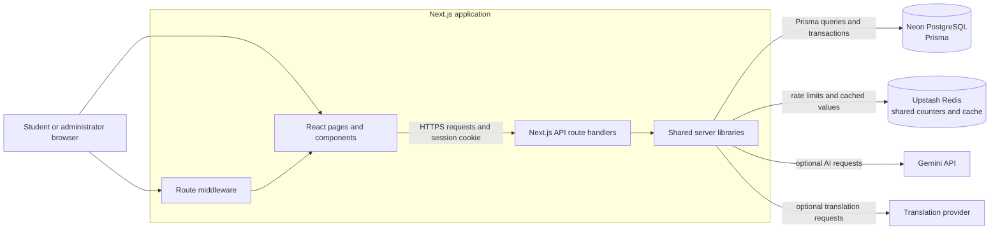

# CivicSense

CivicSense is a bilingual campus issue-management platform. Students can report campus problems, attach evidence, follow progress, and receive administrator responses. Campus administrators get a campus-scoped queue to triage, manage, and resolve reports.

The application is built with Next.js, React, TypeScript, Prisma, and PostgreSQL. Optional AI workflows use Gemini; Upstash Redis coordinates request limits and selected caches across application instances.

## What CivicSense can do

### For students

- Create an account and choose a registered campus.
- Submit an issue in English, Assamese, or a mixture of both.
- Dictate a report in supported browsers using English or Assamese speech recognition, then edit and confirm the transcript before analysis or submission.
- Attach JPEG, PNG, or WebP evidence images (up to 3 MB per image).
- Get AI-assisted category, department, priority, tags, and bilingual summaries when Gemini is configured; local heuristics provide a fallback.
- Review similar open reports before submission. A student chooses whether to link a report; reports are not automatically merged.
- Follow report status, view administrator responses, and receive persisted in-app notifications.
- View campus-specific reports with search, status filters, and cursor pagination.
- Ask Campus Pulse questions about recent campus issues and inspect the report records cited in answers.

### For campus administrators

- Sign up for a campus using the administrator invitation code.
- View and filter reports for their campus.
- Review triage suggestions and manage report status and response workflows.
- Draft and edit bilingual responses with AI assistance, then publish them to affected reporters.
- Review before/after evidence for resolution. The normal workflow requires either successful AI verification or explicit administrator confirmation of a manual review when AI verification is unavailable.
- Export and manage reports using the dashboard tools.
- Use Campus Pulse for campus-scoped, report-grounded summaries of issue patterns and unresolved needs.

The system provides decision support, not authoritative decisions: AI-generated classifications, summaries, duplicate suggestions, and responses should be reviewed by people.

## System architecture



### Frontend

- **Next.js App Router** serves the landing, sign-in, sign-up, student dashboard, and administrator views.
- **React and TypeScript** power the interactive report, settings, dashboard, evidence, and AI-assisted workflows.
- The browser communicates with the same Next.js deployment through `/api/...` endpoints. The frontend does not connect directly to PostgreSQL, Redis, or provider secrets.
- The UI is bilingual and adapts issue intake and response workflows for English and Assamese.
- Voice reporting uses the browser's Web Speech recognition implementation where supported. The app receives editable transcript text, not an uploaded audio recording; support and transcription accuracy depend on the browser, device, language pack, and microphone permission.
- Protected dashboard routes are gated by middleware; APIs separately authenticate and authorize requests.

### Backend

- **Next.js route handlers** implement authentication, campuses, reports, notifications, AI workflows, and health checks.
- **Prisma** provides typed PostgreSQL access. PostgreSQL is the source of truth for users, campuses, reports, and notifications.
- The report API scopes reads and writes to the authenticated user's campus. Complaint lists are cursor-paginated, with a default page size of 50 and a maximum of 100.
- Related report, upvote, status, and notification operations use database transactions where appropriate.
- `/api/health` checks PostgreSQL and Redis and returns dependency status.

### Persistence and evidence

- **Neon PostgreSQL** stores application records. The Prisma schema includes `Campus`, `User`, `Complaint`, and `Notification`.
- Passwords are stored as hashes, not plaintext.
- Evidence images are stored inline in PostgreSQL (not Vercel Blob). Images are validated and limited to 3 MB. Report-list responses omit image payloads; evidence is only included in authenticated, same-campus report detail responses.
- Inline evidence makes deployment simpler but increases database storage and request/response sizes. Plan database storage and backups accordingly.

## Why Redis is used

Redis is an auxiliary shared service, **not** the system of record. CivicSense uses Upstash Redis for:

1. **Shared rate limits:** Atomic Redis counters with expirations help enforce limits consistently across serverless/application instances. This includes authentication attempts, report operations, AI endpoints, translation calls, and a configurable global Gemini request budget.
2. **AI/translation caching:** Selected repeatable analysis and translation results can be cached with a time-to-live, reducing duplicate provider calls, latency, and usage costs.
3. **Multi-instance coordination:** Each application instance can use the same counters/cache rather than maintaining unrelated in-memory state.

Without valid `UPSTASH_REDIS_REST_URL` and `UPSTASH_REDIS_REST_TOKEN`, the app falls back to **instance-local memory** for rate limits and skips shared caching. Local fallback is useful for development, but it does not coordinate limits across multiple instances and should not be treated as production-grade distributed protection. If Redis requests fail, rate-limit code logs the failure and falls back locally; cache errors are logged and the request continues without the cache. `/api/health` reports Redis as not configured or unavailable, as applicable.

## Request and data flows

### Sign-in and authorization

1. The browser sends credentials to `/api/auth/signin`.
2. The server verifies the password hash and issues a signed, HTTP-only session cookie.
3. Middleware uses the session role to direct users away from the wrong dashboard.
4. API handlers verify the session and enforce role/campus rules independently. The cookie is configured as `SameSite=Lax`, `Secure` in production, and has a seven-day lifetime.

Production requires a unique `AUTH_SECRET` of at least 32 characters. Production administrator signup also requires a private `ADMIN_SIGNUP_CODE`.

### Report submission

1. The authenticated student submits report text and optional image evidence.
2. Input and image data are validated and bounded; request limits are checked.
3. AI triage and bilingual summaries may be requested, subject to provider configuration and shared limits. Local rules/templates are used as fallback.
4. The API validates any selected duplicate suggestion, then saves the report and related updates to PostgreSQL.
5. The student and campus administrator views read campus-scoped data through paginated endpoints.

### Voice reporting

The report form can use the browser's SpeechRecognition/Web Speech API to dictate English or Assamese into the description field. The student can stop, edit, and review the transcript before continuing through the existing AI review and explicit submission steps. This is browser-dependent voice recognition, not a server-side audio transcription service; unsupported browsers retain the normal typing workflow. CivicSense does not upload an audio file to its own API, but the browser's speech-recognition implementation may process audio under its provider's terms.

### Campus Pulse

Campus Pulse authenticates the user, scopes its query to the user's campus, reads only a bounded sample of recent report summaries and metadata, and asks Gemini for a concise answer when configured. The model receives no reporter names and must cite report IDs from the supplied evidence; the API filters citations to IDs in that evidence before returning them. A local summary and references remain available when Gemini is missing, rate-limited, or unavailable. Counts are calculated from at most the 120 newest campus records, so this is a useful operational snapshot—not a complete historical analytics warehouse. Users should inspect cited reports before acting.

### Duplicate suggestions

The app compares a bounded set of recent active campus reports and may use text similarity and Gemini to suggest matches, including cross-language suggestions. The suggestion is not a merge: the reporter confirms whether to link the new report to an existing issue.

### Resolution review

An administrator provides after-evidence for a resolution attempt. When available, Gemini compares it with the original evidence. A successful verification or explicit manual-review confirmation produces a short-lived signed token bound to the report and the exact after-image. The update endpoint requires a valid token before accepting a resolution. A failed AI comparison is not treated as a successful verification.

## System design and operational characteristics

- **Stateless application layer:** The Next.js app can run on multiple instances; durable state is in PostgreSQL. Shared Redis counters/cache improve consistency across instances.
- **Pagination and query efficiency:** Complaint lists use cursor pagination, bounded page sizes, campus-scoped queries, and database indexes.
- **Load shedding and cost control:** Rate limits constrain repeated operations and AI provider usage; cached results can avoid duplicate work. Gemini request rate is configurable through `GEMINI_REQUESTS_PER_MINUTE`.
- **Graceful provider fallback:** AI-dependent workflows use local rules or templates when Gemini or translation is not configured or is rate-limited. Fallback quality is lower and must not be presented as a completed AI analysis.
- **Health visibility:** `/api/health` reports database and Redis dependency status.
- **Privacy boundaries:** Session and provider secrets stay on the server. Report queries are authenticated and campus scoped. Translation may send report text to an external provider, and browser speech recognition may process microphone audio under the browser provider's terms; review those data-handling policies before using sensitive information.

These safeguards improve resilience but do **not** certify a particular throughput or availability target. The configured 100-concurrent-request load test must be run against staging before making capacity claims. AI provider quotas, database plan limits, image storage growth, and deployment configuration also affect capacity.

## API overview

| Area | Endpoint(s) | Purpose |
|---|---|---|
| Authentication | `POST /api/auth/signup`, `POST /api/auth/signin`, `POST /api/auth/signout`, `GET /api/auth/me` | Account creation, login, logout, and current session |
| Campuses | `GET /api/campuses` | List registered campuses for signup and campus selection |
| Reports | `GET/POST /api/complaints`, `GET/PATCH /api/complaints/:id` | Paginated, campus-scoped report list, submission, and updates |
| Duplicate suggestions | `POST /api/complaints/duplicates` | Suggest related active reports |
| Notifications | `/api/notifications` | Read and manage persisted notifications |
| AI workflows | `/api/ai/analyse`, `/api/ai/follow-up`, `/api/ai/copilot`, `/api/ai/verify-resolution` | Triage, follow-up, response drafts, and resolution evidence review |
| Campus Pulse | `POST /api/ai/campus-pulse` | Authenticated campus-scoped Q&A with bounded report evidence and validated report citations |
| Health | `GET /api/health` | Check application database and Redis dependencies |

All API routes should be used through the application; protected routes require a valid session and apply role, campus, and input checks as appropriate.

## Technology stack

| Layer | Technology |
|---|---|
| Web application | Next.js 15, React 19, TypeScript |
| API | Next.js App Router route handlers |
| Database | PostgreSQL on Neon |
| ORM | Prisma |
| Shared cache and rate limits | Upstash Redis REST API |
| AI | Gemini (optional; local fallbacks available) |
| Authentication | Signed JWT session cookie using `jose`; password hashing with `bcryptjs` |
| Hosting target | Vercel-compatible Next.js deployment |

## Repository layout

```text
src/
  app/                 Pages and API route handlers
    api/               Authentication, reports, AI, notifications, health
  components/          Student/admin interface and workflows
  lib/                 Authentication, Prisma, Redis, AI, translation, validation
prisma/
  schema.prisma        PostgreSQL data model
  init.sql             Additive database setup and indexes
scripts/
  load-test.mjs        Authenticated read-only load test
```

## Local setup

### Requirements

- Node.js and npm
- A PostgreSQL database (the documented deployment setup uses Neon)
- Optional: Upstash Redis and Gemini credentials for distributed limits/cache and AI features

### Configure environment

Create a `.env` file in the project root. Keep it private and never commit it.

```env
DATABASE_URL="your-postgresql-connection-string"
AUTH_SECRET="a-unique-random-secret-at-least-32-characters"
ADMIN_SIGNUP_CODE="a-private-admin-invitation-code"

# Optional but recommended for multi-instance deployments
UPSTASH_REDIS_REST_URL="your-upstash-redis-rest-url"
UPSTASH_REDIS_REST_TOKEN="your-upstash-redis-rest-token"

# Optional AI and provider controls
GEMINI_API_KEY="your-gemini-api-key"
GEMINI_REQUESTS_PER_MINUTE="8"
```

Set all production secrets in the hosting provider's environment settings for each environment; do not expose them as `NEXT_PUBLIC_*` variables.

### Install, initialize, and run

```bash
npm install
npm run db:generate
npm run db:setup
npm run db:seed
npm run dev
```

Open the local URL printed by Next.js (normally `http://localhost:3000`). For a production build:

```bash
npm run build
npm run start
```

`npm run db:setup` applies the repository's additive SQL setup and indexes. Review database configuration and take backups before applying schema changes to a production database.

## Load testing

The repository includes an authenticated, read-only burst test. It reports request failures and p95 latency; by default it sends 100 concurrent requests using one authenticated session (it does not simulate 100 distinct users). Configure test credentials for a staging account:

```env
LOAD_TEST_BASE_URL="https://your-staging-host"
LOAD_TEST_EMAIL="staging-account@example.com"
LOAD_TEST_PASSWORD="staging-account-password"
LOAD_TEST_CONCURRENCY="100"
```

Then run:

```bash
npm run test:load
```

Run this against staging, not production, and interpret the results against your database, hosting, and provider limits. A successful local build or health check is not a load test. The most recent local burst failed: 23/100 requests returned HTTP 200, 20 returned HTTP 500, and 57 timed out or otherwise failed. Prisma reported connection-pool timeouts; see [AUDIT_LIMITATIONS.md](./AUDIT_LIMITATIONS.md). Do not claim 100-user capacity until the bottleneck is addressed and a production-like staging test passes.

## Current limitations and release checklist

- Some overview dashboard cards (for example satisfaction and average resolution time) are static demo metrics, not measurements computed from current database records. Campus Pulse metrics are live but cover at most the 120 newest reports.
- AI output and translation quality depend on external providers, prompts, quotas, and network availability; human review remains necessary.
- Voice transcription is browser/device dependent; it may be unavailable or inaccurate for some Assamese speakers. The editable transcript and typed-input fallback remain available.
- Campus Pulse only samples the 120 newest campus records and should not be used as exhaustive or audited historical reporting.
- The 100-concurrent-user test must be run on a production-like staging deployment before claiming tested capacity.
- Validate the end-to-end write flows (submit, administrator update/response, and successful resolution) using disposable staging accounts and data.
- Review dependency advisories, configure backups/retention, and monitor database/storage growth from inline images.
- Use private production values for `DATABASE_URL`, `AUTH_SECRET`, `ADMIN_SIGNUP_CODE`, and provider tokens. Rotate any credentials that have been shared.

For the detailed implementation audit, verification results, and remaining gaps, see [AUDIT_LIMITATIONS.md](./AUDIT_LIMITATIONS.md).
